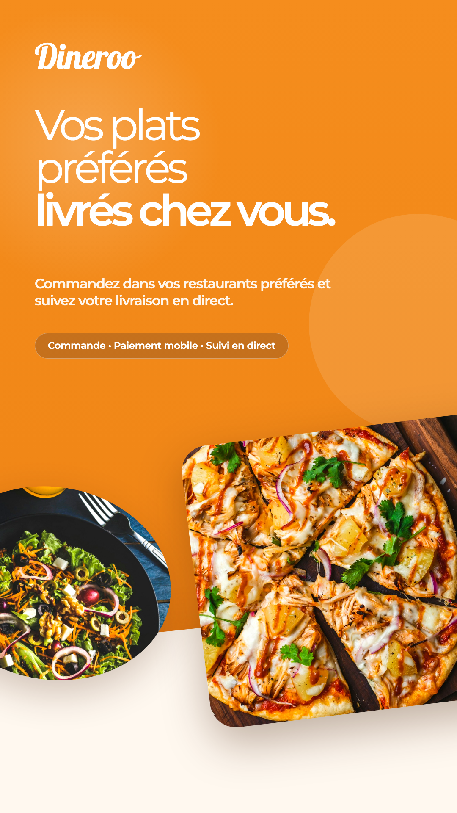
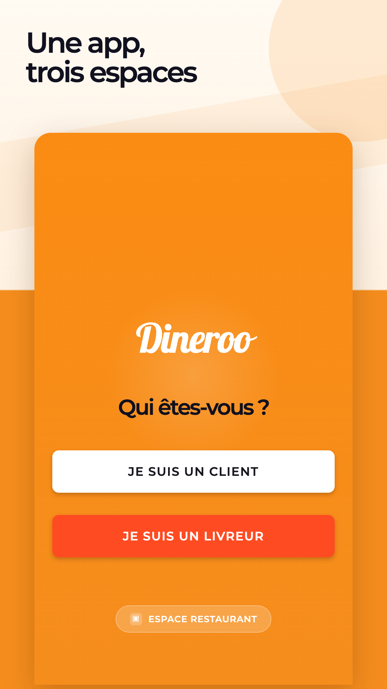
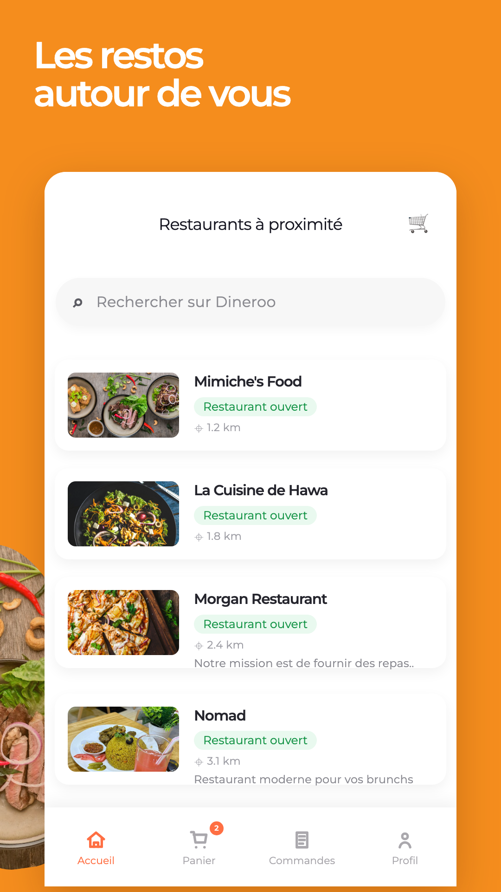
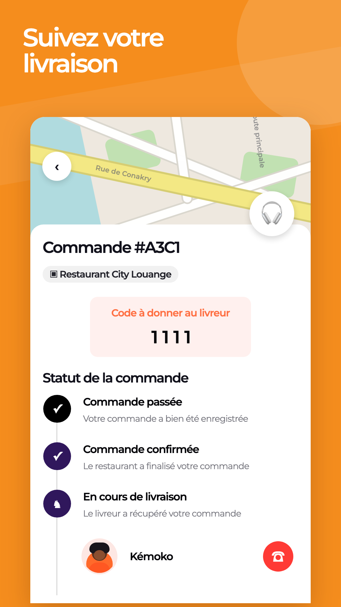
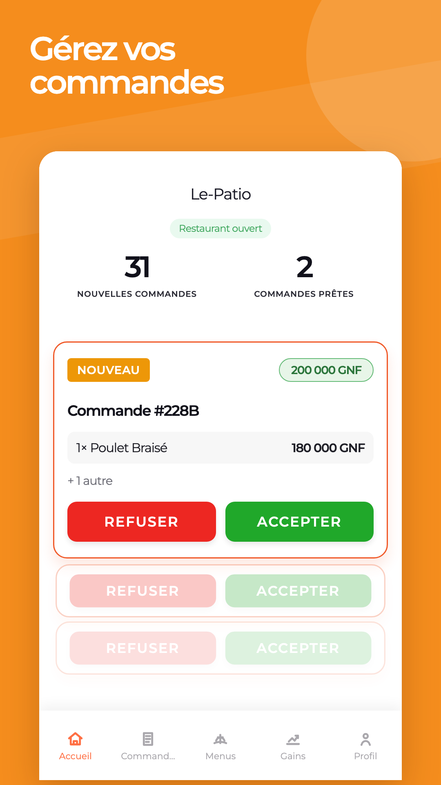
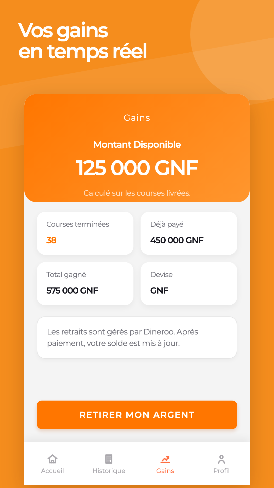

# Dineroo - Présentation du projet

## Le Grand Concours Jeune Entrepreneur 2026

**Domaine :** Numérique  
**Région :** Conakry  
**Projet :** Dineroo  
**Objet :** Plateforme guinéenne de livraison de repas  
**Statut :** Produit prêt techniquement, recherche de financement pour le lancement commercial

<table>
  <tr>
    <td style="width: 50%; text-align: center; vertical-align: top;">
      
      
<em>Aperçu marketing de Dineroo préparé pour le lancement de l'application.</em>

    </td>
    <td style="width: 50%; text-align: center; vertical-align: top;">
      
      
<em>Aperçu de l'application : accès adapté aux clients, livreurs et restaurants.</em>

    </td>
  </tr>
</table>

---

## 1. Résumé exécutif

Dineroo est une plateforme guinéenne de livraison de repas qui connecte les clients, les restaurants partenaires et les livreurs à travers une application mobile disponible sur Android et iOS.

Le projet répond à un besoin concret : faciliter la commande de repas, digitaliser les restaurants locaux, structurer la livraison urbaine et créer des opportunités de revenus pour les jeunes livreurs.

La solution est déjà prête sur le plan technique. Le financement recherché servira principalement à lancer les opérations commerciales, recruter et former les premiers livreurs, équiper l'équipe terrain, intégrer davantage de restaurants partenaires et faire connaître le service auprès des premiers clients.

---

## 2. Problème identifié

En Guinée, le secteur de la restauration et de la livraison reste encore peu digitalisé. Beaucoup de commandes se font par téléphone, par messagerie ou de façon informelle.

Cette situation entraîne plusieurs difficultés :

- Les clients manquent de visibilité sur les menus, les prix, les délais et la disponibilité des restaurants.
- Les restaurants perdent des ventes faute de présence digitale structurée.
- Les commandes peuvent être mal suivies, retardées ou mal coordonnées.
- Les restaurants doivent souvent gérer eux-mêmes la logistique de livraison.
- Les jeunes livreurs manquent de plateformes organisées pour travailler de manière flexible et rémunératrice.

Dineroo veut apporter une réponse locale, moderne et adaptée au contexte guinéen.

---

## 3. Solution proposée

Dineroo centralise toute la chaîne de valeur de la livraison de repas dans une plateforme unique.

  
  
<em>Aperçu de l'application client : découverte des restaurants disponibles.</em>

La plateforme comprend :

- Une application mobile client pour consulter les restaurants, choisir des plats, passer commande, payer et suivre la livraison.
- Un espace livreur pour se connecter, recevoir des courses, accepter des livraisons, suivre les trajets et consulter les gains.
- Un espace restaurant/manager pour recevoir les commandes, les accepter ou les refuser, gérer les menus, les produits, les horaires et les revenus.
- Une interface admin web pour suivre les clients, les livreurs, les restaurants, les commandes, les paiements et les indicateurs d'activité.
- Un backend sécurisé qui gère les utilisateurs, les restaurants, les commandes, les paiements, les livraisons, les notifications et l'import de catalogues.

Dineroo n'est donc pas seulement une application de commande. C'est une infrastructure numérique locale pour organiser la livraison de repas en Guinée.

---

## 4. Fonctionnement

### Côté client

Le client crée un compte, consulte les restaurants disponibles, choisit ses plats, ajoute les articles au panier, renseigne son adresse, choisit son mode de paiement, valide la commande et suit la livraison en temps réel.

  
  
<em>Aperçu de l'application client : suivi de commande en temps réel.</em>

### Côté restaurant

Le restaurant reçoit les commandes en temps réel, peut les accepter ou les refuser, gérer son catalogue, ses menus, ses produits, ses horaires d'ouverture et suivre ses revenus.

  
  
<em>Aperçu de l'espace restaurant : réception et gestion des commandes.</em>

### Côté livreur

Le livreur se connecte à l'application, passe en ligne, reçoit des propositions de livraison, accepte une course, récupère la commande au restaurant, livre le client et confirme la livraison avec un code.

  
  
<em>Aperçu de l'espace livreur : suivi des gains.</em>

### Côté administration

L'équipe Dineroo suit les opérations depuis une interface admin : commandes, paiements, livreurs, restaurants, clients, alertes et indicateurs de performance.

---

## 5. Public cible

Dineroo cible principalement :

- Les clients urbains qui souhaitent commander des repas rapidement.
- Les restaurants, fast-foods, pâtisseries, snacks et cuisines locales qui veulent augmenter leurs ventes.
- Les jeunes livreurs disposant d'un smartphone et d'un moyen de déplacement.
- Les entreprises, bureaux et professionnels qui commandent régulièrement des repas.

Le lancement peut commencer à Conakry, avant une extension progressive vers d'autres communes et villes de Guinée.

---

## 6. État d'avancement

Le projet est déjà prêt sur le plan technique. Les principaux modules nécessaires au lancement sont en place :

- Application mobile Flutter compatible Android et iOS.
- Parcours client : inscription, restaurants, menus, panier, commande, paiement et suivi.
- Parcours livreur : disponibilité, réception de courses, livraison, confirmation et gains.
- Parcours restaurant/manager : réception des commandes, catalogue, menus, horaires et disponibilité.
- Interface admin web pour le suivi des opérations.
- Backend structuré en services : utilisateurs, restaurants, commandes, paiements, livraison, notifications et import de catalogues.
- Sécurité avec authentification, rôles et autorisations.

La priorité actuelle est le financement du lancement commercial et opérationnel.

---

## 7. Modèle économique

Dineroo peut générer des revenus à travers plusieurs sources :

- Commission sur chaque commande passée via la plateforme.
- Frais de livraison payés par le client.
- Frais de service sur certaines transactions.
- Offres premium pour les restaurants qui souhaitent plus de visibilité.
- Services additionnels de promotion et de gestion digitale pour les restaurants partenaires.

Ce modèle permet de créer une activité durable tout en apportant de la valeur aux clients, aux restaurants et aux livreurs.

---

## 8. Plan de lancement

Le lancement commercial peut se faire progressivement :

1. Identifier une première zone de livraison à forte demande.
2. Intégrer un premier groupe de restaurants partenaires.
3. Recruter, former et équiper les premiers livreurs.
4. Lancer une campagne de communication locale et digitale.
5. Accompagner les premières commandes avec un support client réactif.
6. Mesurer les performances : délais de livraison, satisfaction client, commandes, revenus restaurants et gains livreurs.
7. Étendre progressivement le service à d'autres zones.

---

## 9. Besoin de financement

Le financement demandé permettra d'accélérer le passage de la phase technique à la phase commerciale.

Les fonds seront utilisés pour :

- Recruter et former les premiers livreurs.
- Acheter des sacs isothermes, équipements de livraison et supports d'identification.
- Financer les premières campagnes marketing.
- Intégrer et accompagner les restaurants partenaires.
- Renforcer le support client et les opérations terrain.
- Améliorer l'application mobile et l'infrastructure technique.
- Déployer progressivement le service dans les premières zones ciblées.

---

## 10. Impact attendu

Dineroo aura un impact économique et social important :

- Création d'emplois et de revenus pour les jeunes livreurs.
- Augmentation du chiffre d'affaires des restaurants partenaires.
- Digitalisation du secteur de la restauration en Guinée.
- Amélioration de l'expérience client dans la commande et la livraison de repas.
- Structuration d'un réseau local de logistique urbaine.
- Valorisation des restaurants guinéens et de la cuisine locale.

---

## 11. Conclusion

Dineroo est une solution guinéenne, moderne et durable pour faciliter la livraison de repas, soutenir les restaurants locaux, créer des revenus pour les jeunes et contribuer à la transformation numérique du commerce en Guinée.

Le produit est prêt techniquement. Le financement recherché permettra de lancer officiellement les opérations et de transformer cette solution en une entreprise locale à fort impact.
